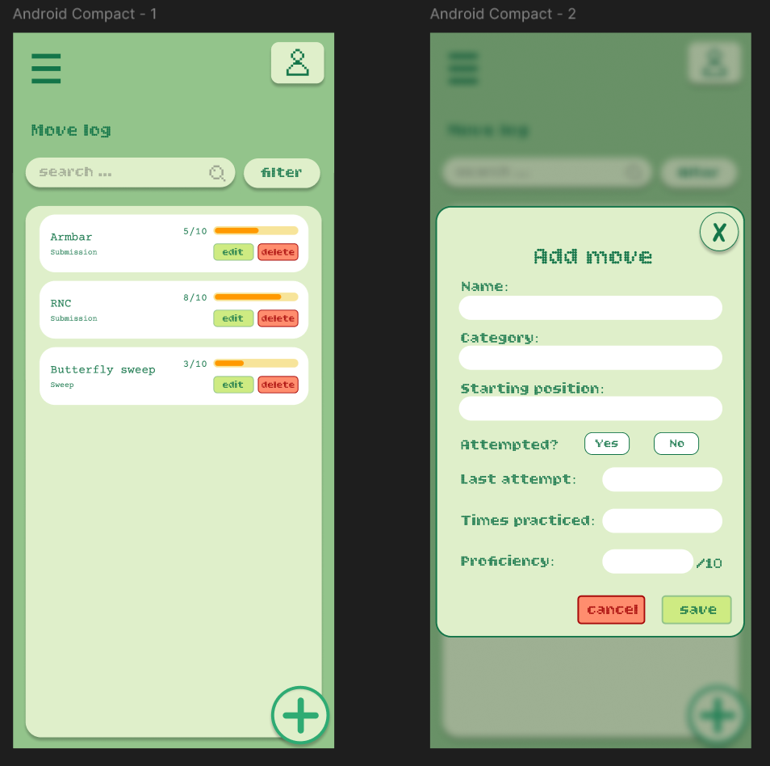

# Jiu Jitsu move log

# 1. Description:
App description: This is an app for people who train Brazilian Jiu Jitsu and want to keep track of the moves they're learning. 
You can save each move with its category and starting position. After practicing, you note whether you've tried it, when you last did it, how many times you've done it, and how well it went on a scale of 1 to 10. Over time, you can see which moves you've mastered and which ones need more drilling.
The app is single user, with possible future implementations of user accounts. 

# 2. Domain details:
Move entity
- name: armbar, RNC, guillotine choke etc
- category: submission, sweep, escape etc
- starting position: mount, side control , guard etc.
- attempted: yes/no - did you try this move?
- last attempt: date with the last attempt
- times practiced: In how many sessions have you tried the move
- proficiency: how well you've mastered this move 1-10

# 3. CRUD:
- Create: The user taps the add button ("+") and fills in a form: name, category, starting position , etc. The name and category fields are mandatory. After saving, the new move appears in the list.
- Read: The added moves are all placed in a list and can be filtered by category. 
- Update: The user clicks the update button and gets to modify details about a move. The form that is used in this case is already pre-filled with the existing information. Any detail can be changed. After the user saves, the updated entity will replace the old one in the list. 
- Delete: The user has the option to delete an entry. Upon clicking the delete button, a second prompt will appear ,asking for confirmation in order to avoid accidental deletion. After the choice is confirmed, the move is removed from the list. 

# 4. Persistence details: which CRUD operations are persisted on the local DB and on the server.
-> Create, Update and Delete are persisted on the local DB and the server. For example, deleting a move removes it from the phone and from the server. Read displays the moves stored locally, which are kept in sync with the server. 

# 5. When offline
-> When the device is offline, the user can see and interact with a local copy of the data, and the server updates later.
- Create: When you add a move offline, the entry is stored in the local DB and the server updates after the device is connected to the internet once more.
- Read: The list shows entries from the local DB. It will update with any changes that might happen server-wise in the meantime only after it gains access to it again. A note will show up mentioning that the user is offline.
- Update: The edit is saved locally and updates the server entry once reconnected. 
- Delete: The move is deleted locally and when the device reconnects, it is also removed from the server.
The changes remain saved even in the case of an app restart, because they get saved in a local DB.

# Mockups 
I used figma

